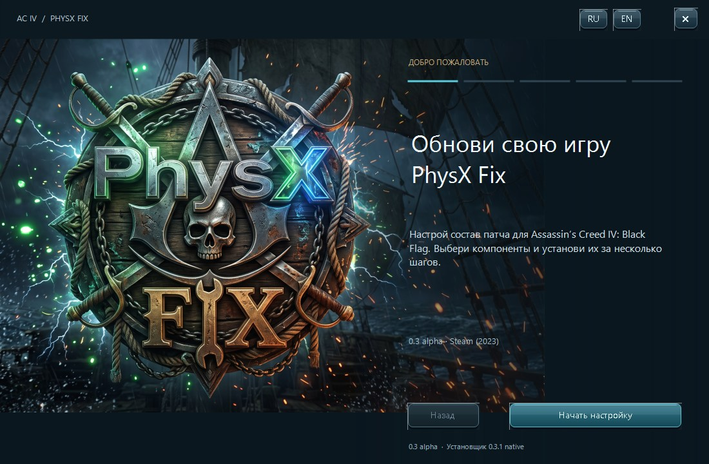
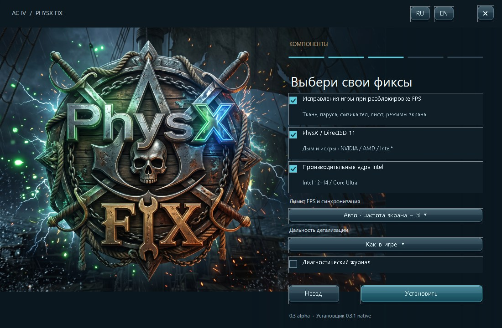

# AC4 PhysX Fix

[Русский](README_RU.md) · [Downloads / Releases](../../releases) · [Build instructions](BUILD.md) · [Validation](docs/VALIDATION.md)

Modular fixes and Direct3D 11 PhysX for **Assassin’s Creed IV: Black Flag**, with a native Windows installer, Russian/English interface and tracked uninstall.

**Alpha / test release.** The game fixes are the original supplied **0.3 alpha** payload. **0.3.1** identifies the new native installer and packaging; it does not claim a new version of the game-fix DLLs.



## Downloads

Open **[Releases](../../releases)** and choose one installation method:

| File | Purpose |
|---|---|
| `AC4-PhysX-Fix-Setup.exe` | Recommended native installer with component selection, validation, update and removal |
| `AC4-PhysX-Fix-0.3.1-Nexus-Manual.zip` | Manual file installation, with RU/EN instructions |
| `AC4-PhysX-Fix-0.3.1-Installer-Source.zip` | Installer project and supplied binary payload bundle |
| `SHA256SUMS.txt` | Checksums of those release files |

Do not install both methods over each other. Releases are unsigned; neither signing reputation nor antivirus/site approval is guaranteed.

## Supported game

The original compatibility restriction is retained: **Steam (2023)** with this SHA-256 of `AC4BFSP.exe`:

```text
bc11ad7924e1eca7363ee86aa3332c05386d0a05896c0b7370131daee9ab5150
```

Other executables are rejected by setup. A Steam purchase alone does not establish compatibility. The patch targets single-player; do not assume multiplayer or anti-cheat compatibility.

## Components

- **Game fixes for unlocked FPS:** cloth/sail movement, ragdoll behavior, elevator operation and display modes.
- **PhysX through Direct3D 11:** campfire smoke and sparks. The source project targets NVIDIA, AMD and Intel; its notes document RTX 5090 + i9-14900K testing. AMD/Intel hardware validation is still needed.
- **Intel performance cores:** optional on supported Intel 12th–14th gen / Core Ultra CPUs.
- **FPS cap and draw distance:** automatic cap = monitor refresh rate − 3, or a custom limit. Example: 144 Hz → 141 FPS. A limiter alone does not enable synchronization or guarantee tear-free output.



## Install and remove

Close the game, run setup, select RU/EN and click Get started. Setup searches known Steam/Ubisoft Connect locations; Browse selects the game directory manually. Select components and install, then launch the game normally. Run setup again to modify components or remove the patch. Protected game directories may require Run as administrator.

Setup does not overwrite the original game EXE or game data. It tracks patch files, rejects foreign replacements, stages changes and rolls back failures. Changed settings and logs are backed up under `%LOCALAPPDATA%/AC4-Modular-Patch/Removed/`. Unknown files and pre-existing user configuration are retained. See [removal details](docs/INSTALLATION.md).

For the manual ZIP, extract it elsewhere first. Copy the **contents of `GAME_FILES`**, not the folder itself, next to `AC4BFSP.exe`. Stop if any supplied destination file/folder already exists. Read the included instructions before copying.

## Engineering status

The native x86 installer uses static CRT and Windows system libraries. No PowerShell launcher, Python, .NET, WebView2, downloaded runtime or network installer is used. Build tools may download a pinned, hash-verified third-party header on the development machine.

Local checks: **99 engine assertions + 415 original-package/manual-ZIP assertions**, plus native screen rendering at three DPI scales. These are installation tests, not gameplay verification. Clean Windows VM testing and supported-game/AMD/Intel gameplay checks remain outstanding. See [validation and limitations](docs/VALIDATION.md).

This repository publishes installer source and the supplied compiled patch payload. It does **not** contain the source code of the game-fix DLLs. Third-party license information is in [LICENSE-SCOPE.md](LICENSE-SCOPE.md).
